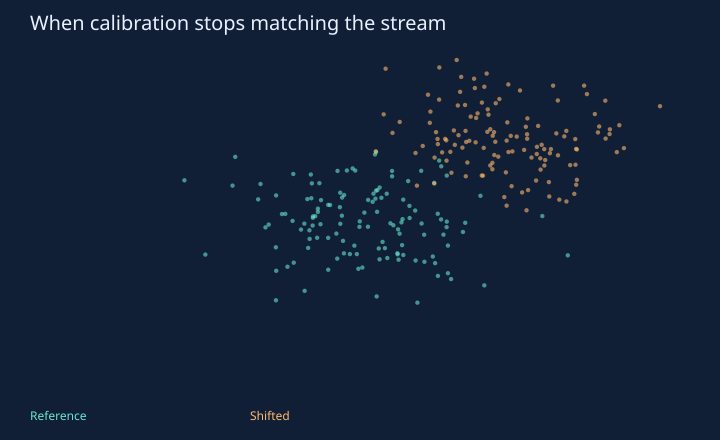
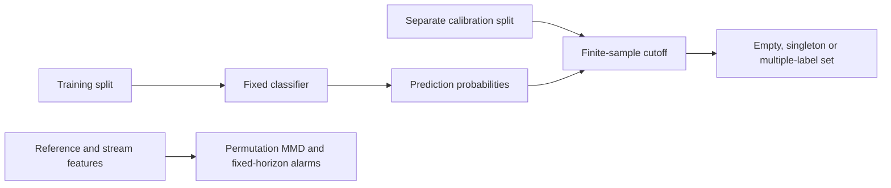

# Conformal Watch

**Prediction sets meet a changing world.**

[](https://github.com/aymaw/conformal-watch/actions/workflows/ci.yml)
[](LICENSE)




New original, AI-assisted personal work, November 2026. All task data are synthetic.
No API key, pretrained download or private data is required. See [provenance](PROVENANCE.md).

## Run it

```bash
# Python 3.11–3.13. uv.lock freezes the dependency graph.
uv sync --frozen --extra dev
uv run pytest -q
uv run python -m conformalwatch.experiment --out runs/reference
uv run python -m http.server 8765 --bind 127.0.0.1
```

Open `http://127.0.0.1:8765/runs/reference/demo.html` for the new run, or
`http://127.0.0.1:8765/results/demo.html` for the committed measured report.
The self-contained HTML also opens directly from disk. Stop the local server with Ctrl+C.

For a short correctness run, add `--quick --out runs/smoke`. Quick output is explicitly
labeled and is not the committed reference result. Training and checkpoints stay in
ignored `runs/`; reports include seeds/configuration, raw metrics and environment details.

## Inside the experiment

A NumPy softmax classifier is trained on synthetic three-class data. A disjoint
calibration split supplies scores `1 - p(true_class)`. For requested miscoverage
`alpha`, the cutoff is the `ceil((n+1)*(1-alpha))`-th smallest score. If that rank
exceeds `n`, the cutoff is infinity and every class is included. Ties are included.
No interpolation, test-set tuning, or forced argmax is used. Empty sets are allowed;
only singleton sets are treated as actionable predictions.

A separate label-free diagnostic uses biased RBF MMD² with fixed bandwidth 2.0,
499 seeded permutations and the finite permutation p-value `(1 + exceedances)/(B+1)`.
There are exactly six planned windows; each uses significance `0.05/6`. Reusing the
reference creates dependence, but Bonferroni does not require independence. This
budget does not cover indefinite monitoring, retraining, or repeatedly restarting
the experiment. A drift alarm does not restore a conformal guarantee.



## Measured result

| Slice | Coverage | Mean set size | Singleton fraction | Singleton error |
| --- | --- | --- | --- | --- |
| IID | 0.891 | 1.547 | 0.510 | 0.134 |
| covariate shift | 0.572 | 1.256 | 0.744 | 0.434 |

Mean IID coverage across 100 independent calibrations: **0.8992**. The first three unshifted windows did not alarm; all three shifted windows did.


The main run uses 2,500 training rows, 1,000 calibration rows and 2,000 rows per
reported slice. A second experiment averages coverage over 100 independent pairs
of 300-row calibration and 500-row IID test samples with the classifier held fixed.
The shift translates both feature coordinates by 2.5 while keeping the nonlinear
`P(Y|X)` fixed. The intentionally linear model is misspecified in this region.
This is covariate shift, not a label-distribution relabeling trick.

## Visual demo

Move the alpha slider to recompute the exact calibration rank and prediction-set
sizes over a fixed feature grid. The slider does not retrain the classifier, rerun
the stream, or promise simultaneous validity across interactively chosen alphas.
The report shows coverage, set size, singleton fraction, singleton error and each
window's raw p-value and alarm decision.

## Tests and limits

Tests cover finite-sample ranks, ties, tiny calibration samples, empty sets,
invalid probabilities/labels, permutation reproducibility and repeated IID coverage.
The coverage guarantee is marginal over exchangeable calibration/test samples,
not conditional on a particular calibration sample, group, class or feature vector.
Individual runs may fall below 90%. Singleton error can exceed 10%; abstention does
not turn marginal coverage into selective-risk control. Shifted examples violate
the guarantee's assumptions. No clinical, fairness or production-monitoring claim.

## Method references

- [Angelopoulos & Bates, A Gentle Introduction to Conformal Prediction](https://arxiv.org/abs/2107.07511).
- [Gretton et al., A Kernel Two-Sample Test](https://jmlr.org/papers/v13/gretton12a.html).

## Code map

- `src/conformalwatch/core.py`: mathematical and inference primitives.
- `src/conformalwatch/experiment.py`: seeded experiment and CLI.
- `src/conformalwatch/visual.py`: dependency-free HTML/SVG reports.
- `tests/`: mathematical checks and failure-path regressions.
- `results/`: executed measurements, static preview, interactive report and provenance.
- `.github/workflows/ci.yml`: frozen install, lint, tests, quick experiment and package build on three Python versions.

Original implementation and generated fixtures: [MIT](LICENSE).
